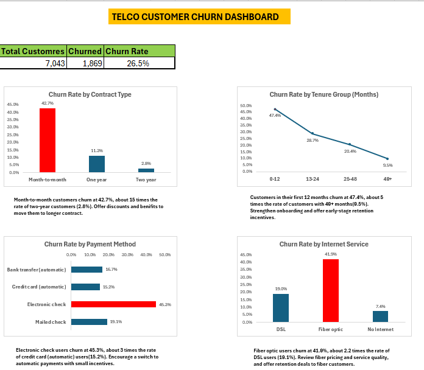
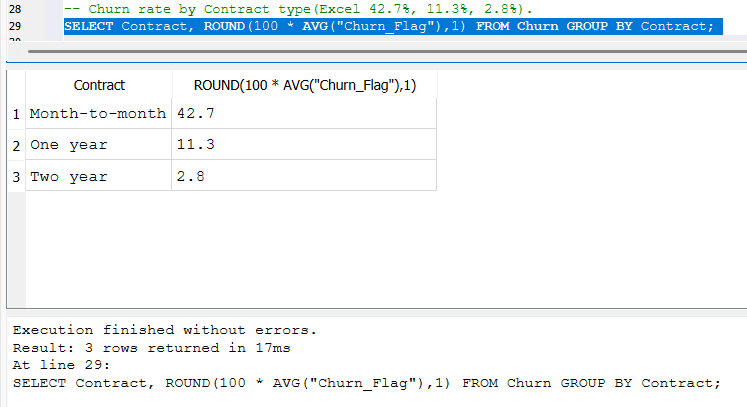
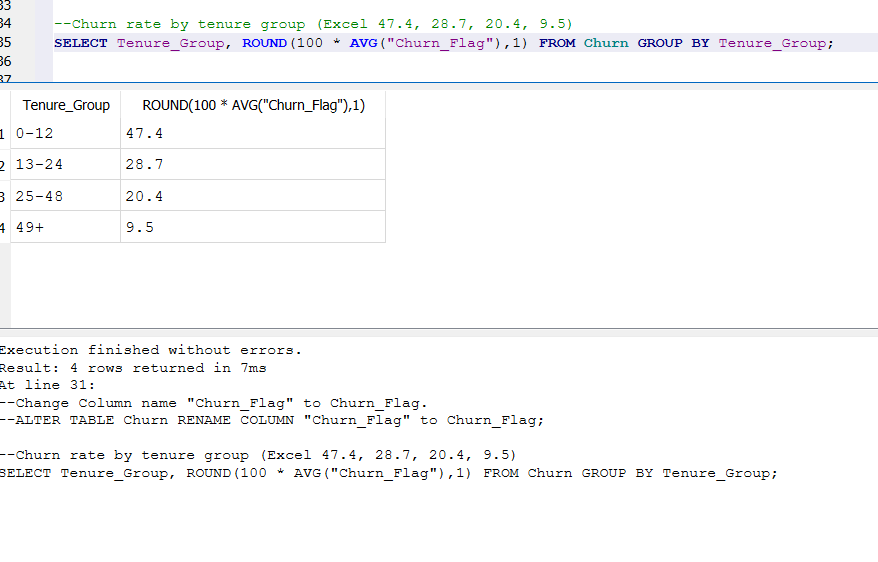
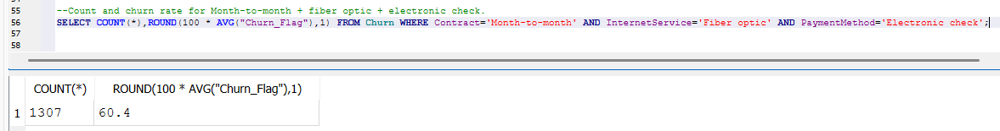
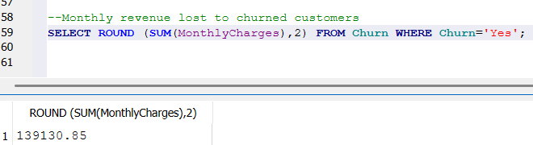

# Customer Churn Analysis

## 1. Project Overview

This project focuses on analyzing customer churn in a telecommunications company using the IBM Telco Customer Churn dataset.

The objective is to understand customer behavior, identify factors contributing to customer churn, and generate meaningful business insights that can help improve customer retention.

## 2. Project Objectives

- Understand customer data and its structure.
- Identify and handle missing values.
- Perform data cleaning and validation.
- Analyze customer churn patterns.
- Identify factors influencing customer churn.
- Generate actionable business insights.

## 3. Dataset Description

- **Dataset:** IBM Telco Customer Churn Dataset
- **Source:** Kaggle – BlastChar
- **Total Records:** 7,043
- **Total Columns:** 21
- **File Format:** CSV

Dataset Link: https://www.kaggle.com/datasets/blastchar/telco-customer-churn

## 4. Tools Used

- Microsoft Excel (data cleaning, EDA, dashboard)
- SQL with DB Browser for SQLite (verification and new insights)
- Power BI (planned)
- GitHub

## 5. Data Preparation and Cleaning

### Workbook Structure
| Sheet | Purpose |
|---|---|
| Raw_Data | Original dataset, never modified |
| Cleaned_data | Data after quality fixes |
| Analysis_data | Cleaned data plus derived columns, used for analysis |
| EDA | PivotTables |
| Chart_Data | Small tables used to build charts |
| Dashboard | Final Excel dashboard |
| Dataquality_log | Record of every issue found and fixed |
| Data_prep_log | Record of derived columns |

### Step 1: Data Import
- Downloaded the IBM Telco Customer Churn dataset from Kaggle and imported the CSV into Excel.
- Confirmed 7,043 records and 21 columns.

### Step 2: Preserve Original Data
- Kept the original data in `Raw_Data` untouched.
- Created `Cleaned_data` as a copy for all cleaning work.

### Step 3: Missing Value Check (TotalCharges)
- `ISBLANK` returned no blanks, but this was misleading: 11 cells contained a hidden space.
- Detected them with `=SUMPRODUCT(--(TRIM(T2:T7044)=""))` (result: 11).
- Verified with `=COUNTIFS(T2:T7044,0,F2:F7044,0)` that all 11 rows have tenure = 0, so they are new customers who have not been billed yet.
- Replaced the 11 blanks with 0 and converted the column to Number.
- Result: blanks 11 → 0; `COUNT` of TotalCharges = 7,043.

### Step 4: Duplicate Check
- Checked CustomerID with `=SUMPRODUCT(--(COUNTIF(A2:A7044,A2:A7044)>1))`.
- Result: 0 duplicates.

### Step 5: Categorical Consistency
- Reviewed distinct values of every categorical column using filters. No spelling or case issues found.
- Replaced "No phone service" with "No" in MultipleLines (682 cells).
- Replaced "No internet service" with "No" in the six internet add-on columns (9,156 cells).
- Reason: these values mean the same as "No", and keeping them would split one category in two.
- Converted SeniorCitizen from 0/1 to No/Yes (5,901 No, 1,142 Yes; total 7,043) to match the other columns.

## 6. Data Preparation (Analysis_data)

New columns were created in a separate sheet so `Cleaned_data` stays intact.

| Column | Rule | Check |
|---|---|---|
| Churn_Flag | Yes = 1, No = 0 | Sum = 1,869 churned customers (26.5% churn rate) |
| Tenure_Group | 0-12, 13-24, 25-48, 49+ months | Groups total 7,043 |
| Charge_Band | Low (< 35), Medium (35 to 69.99), High (70+) monthly charges | Bands total 7,043 |

Charge_Band thresholds are my own choice, picked to split the 18 to 119 monthly charge range into roughly even groups.

## 7. Exploratory Data Analysis (EDA)

All analysis was done with PivotTables in the `EDA` sheet, built from `Analysis_data`. Churn_Flag is 1/0, so its average equals the churn rate.

### 7.1 Overall Churn Rate
- Total customers: 7,043
- Churned customers: 1,869
- **Overall churn rate: 26.5%**

### 7.2 Churn Rate by Contract Type

| Contract | Customers | Churn Rate |
|---|---|---|
| Month-to-month | 3,875 | 42.7% |
| One year | 1,473 | 11.3% |
| Two year | 1,695 | 2.8% |
| **Total** | **7,043** | **26.5%** |

**Findings:**
- Month-to-month customers churn at 42.7%, about 15 times the rate of Two year customers (2.8%).
- 55% of all customers (3,875 of 7,043) are on month-to-month contracts, which makes this the largest risk group.
- Longer contracts are associated with lower churn. This shows an association, not proof that the contract itself causes retention.

### 7.3 Churn Rate by Tenure Group

| Tenure Group (months) | Customers | Churn Rate |
|---|---|---|
| 0-12 | 2,186 | 47.4% |
| 13-24 | 1,024 | 28.7% |
| 25-48 | 1,594 | 20.4% |
| 49+ | 2,239 | 9.5% |
| **Total** | **7,043** | **26.5%** |

**Findings:**
- Churn falls steadily as tenure increases, from 47.4% in the first year to 9.5% after four years.
- Customers in their first 12 months churn at about 5 times the rate of customers with 49+ months.
- 31% of all customers (2,186 of 7,043) are in their first year, so early-life retention is a key opportunity.
- This shows an association, not proof of cause.

### 7.4 Churn Rate by Payment Method

| Payment Method | Customers | Churn Rate |
|---|---|---|
| Bank transfer (automatic) | 1,544 | 16.7% |
| Credit card (automatic) | 1,522 | 15.2% |
| Electronic check | 2,365 | 45.3% |
| Mailed check | 1,612 | 19.1% |
| **Total** | **7,043** | **26.5%** |

**Findings:**
- Electronic check users churn at 45.3%, about 3 times the rate of customers on automatic payments (15.2% and 16.7%).
- Electronic check is also the largest group, with 34% of all customers (2,365 of 7,043).
- Automatic payment methods have the lowest churn.
- This is an association. Electronic check users may also be mostly month-to-month customers, so part of this effect may come from contract type.

### 7.5 Churn Rate by Internet Service

| Internet Service | Customers | Churn Rate |
|---|---|---|
| DSL | 2,421 | 19.0% |
| Fiber optic | 3,096 | 41.9% |
| No internet service | 1,526 | 7.4% |
| **Total** | **7,043** | **26.5%** |

**Findings:**
- Fiber optic customers churn at 41.9%, about 2.2 times the rate of DSL customers (19.0%).
- Fiber optic is the largest group, with 44% of all customers (3,096 of 7,043).
- Customers without internet service have the lowest churn at 7.4%.
- This is an association. Price, service quality and contract type may all play a role, and this data cannot show which one drives the difference.

### 7.6 Churn Rate by Monthly Charge Band

Bands: Low (< 35), Medium (35 to 69.99), High (70+) monthly charges.

| Charge Band | Customers | Churn Rate |
|---|---|---|
| Low | 1,731 | 10.9% |
| Medium | 1,721 | 23.6% |
| High | 3,591 | 35.5% |
| **Total** | **7,043** | **26.5%** |

**Findings:**
- Churn rises with monthly charges, from 10.9% in the Low band to 35.5% in the High band, about 3.3 times higher.
- The High band holds 51% of all customers (3,591 of 7,043).
- This is an association. High charges overlap with services such as fiber optic, so the effect cannot be attributed to price alone.

### 7.7 Churn Rate by Senior Citizen Status

| Senior Citizen | Customers | Churn Rate |
|---|---|---|
| No | 5,901 | 23.6% |
| Yes | 1,142 | 41.7% |
| **Total** | **7,043** | **26.5%** |

**Findings:**
- Senior citizens churn at 41.7%, about 1.8 times the rate of other customers (23.6%).
- They make up only 16% of all customers (1,142 of 7,043), so their share of total churn is smaller than the rate suggests.
- This is an association and does not explain why the gap exists.

### 7.8 Average Monthly Charges: Churned vs Retained

| Churn | Avg Monthly Charges |
|---|---|
| No (retained) | 61.27 |
| Yes (churned) | 74.44 |
| **All customers** | **64.76** |

**Findings:**
- Churned customers paid on average 13.17 more per month than retained customers (about 21% higher).
- This agrees with the charge band result, where churn rises with monthly charges.
- This is an association, not proof that price causes churn.

## 8. Excel Dashboard



The dashboard (`Dashboard` sheet) shows three KPIs (7,043 customers, 1,869 churned, 26.5% churn rate) and four charts. The highest-churn group in each chart is highlighted in red.

| Chart | Type | Key message |
|---|---|---|
| Churn Rate by Contract Type | Column | Month-to-month customers churn at 42.7%, about 15 times the rate of two-year customers (2.8%). |
| Churn Rate by Tenure Group | Line | Customers in their first 12 months churn at 47.4%, about 5 times the rate of customers with 49+ months (9.5%). |
| Churn Rate by Payment Method | Bar | Electronic check users churn at 45.3%, about 3 times the rate of credit card (automatic) users (15.2%). |
| Churn Rate by Internet Service | Column | Fiber optic users churn at 41.9%, about 2.2 times the rate of DSL users (19.0%). |

## 9. SQL Analysis

The goal of this stage was to confirm the Excel results with SQL and to find new insights that the single-factor PivotTables could not show. All queries are saved in `churn_queries.sql`.

### 9.1 Setup
- Exported the `Analysis_data` sheet as CSV and imported it into a SQLite database (`Churn.db`) using DB Browser for SQLite. The table is named `Churn`.
- First import mistake: the "column names in first line" option was missed, so columns were named field1, field2 and so on. Fixed by deleting the table and importing again.
- The column `Churn_Flag` had been typed with a space in Excel (`Churn _Flag`). Renamed it with `ALTER TABLE Churn RENAME COLUMN "Churn _Flag" TO Churn_Flag;`.

### 9.2 Verification of Excel Results

| Check | SQL result | Matches Excel |
|---|---|---|
| Total customers | 7,043 | Yes |
| Churned customers | 1,869 | Yes |
| Month-to-month customers | 3,875 | Yes |
| Two year customers | 1,695 | Yes |
| Fiber optic customers | 3,096 | Yes |
| Churn rate by Contract | 42.7%, 11.3%, 2.8% | Yes |
| Churn rate by Tenure Group | 47.4%, 28.7%, 20.4%, 9.5% | Yes |
| Churn rate by Payment Method | 16.7%, 15.2%, 45.3%, 19.1% | Yes |
| Churn rate by Internet Service | 19.0%, 41.9%, 7.4% | Yes |
| Churn rate by Charge Band | 10.9%, 23.6%, 35.5% | Yes |
| Churn rate by Senior Citizen | 23.6%, 41.7% | Yes |
| Avg monthly charges (retained, churned) | 61.27, 74.44 | Yes |

**Churn rate by contract type(SQL result):**



**Churn rate by tenure group(SQL result):**




The churn rate queries follow this pattern, changing only the grouping column:

```sql
SELECT Contract, ROUND(100 * AVG(Churn_Flag), 1)
FROM Churn
GROUP BY Contract;
```

### 9.3 New Insights (not available in Excel)

**High-risk segment: month-to-month + fiber optic + electronic check**

```sql
SELECT COUNT(*), ROUND(100 * AVG(Churn_Flag), 1)
FROM Churn
WHERE Contract = 'Month-to-month' AND InternetService = 'Fiber optic' AND PaymentMethod = 'Electronic check';
```
**Combined high-risk segment(month-to-month + fiber optic + electronic check);**




- 1,307 customers (about 18.6% of all customers) fall into this segment.
- Their churn rate is **60.4%**, about 2.3 times the overall rate of 26.5%.
- This is roughly 790 churned customers, about 42% of all churn (calculated from the rounded rate).

**Monthly revenue lost to churn**

```sql
SELECT ROUND(SUM(MonthlyCharges), 2) FROM Churn WHERE Churn = 'Yes';
```
**Monthly revenue lost to churned customes**




- Churned customers paid **139,130.85** per month in total (currency not stated in the dataset).
- This is about 30% of total monthly revenue (7,043 customers x 64.76 average).
- A simple projection (x 12) gives about 1.67 million per year, assuming these customers would have stayed.

### 9.4 What I Learned
- In SQL, single quotes mark a text value (`'Yes'`) and double quotes mark a column name. Mixing them up returned 0.0 with no error.
- `GROUP BY` does the same job as putting a field in the Rows area of a PivotTable.
- `DISTINCT` shows the exact spelling and case of values before filtering on them.
- Reading the error message and checking the table schema is the fastest way to find a mistake.

## 10. Key Insights and Recommendations

### Highest-risk segments
- Month-to-month contracts: 42.7% churn, 55% of all customers.
- First 12 months of tenure: 47.4% churn, 31% of all customers.
- Electronic check payment: 45.3% churn, 34% of all customers.
- Fiber optic internet: 41.9% churn, 44% of all customers.
- High monthly charges (70+): 35.5% churn, 51% of all customers.
- **Combined segment (month-to-month + fiber optic + electronic check): 60.4% churn, 18.6% of all customers.**

### Recommendations
1. **Target the combined high-risk segment first.** About 1 in 5 customers account for roughly 42% of all churn, so focused retention offers here give the biggest return.
2. **Move customers to longer contracts.** Offer discounts or benefits to month-to-month customers for switching to one or two year plans.
3. **Strengthen early-life retention.** Improve onboarding and offer retention incentives in the first 12 months, when churn is highest.
4. **Encourage automatic payments.** Offer small incentives for switching from electronic check to bank transfer or credit card autopay.
5. **Review the fiber optic offer.** Check pricing and service quality for fiber customers and consider targeted retention deals.

Churn removes about 30% of monthly revenue, so even a small reduction in churn has a large financial impact.

## 11. Limitations

- All findings are associations, not proof of cause. Overlapping factors (for example electronic check and month-to-month contracts) can share the same effect.
- Only one combination of factors was analyzed in SQL. Other combinations, such as tenure with contract type, were not covered.
- The revenue estimate is a simple projection and assumes churned customers would have stayed for a full year.
- Charge_Band thresholds (35 and 70) are my own choice.

## 12. Current Project Status

Data cleaning, data preparation, EDA, the Excel dashboard and the SQL analysis are complete. Next stage: Power BI dashboard.

## 13. Upcoming Tasks

1. Upload `churn_queries.sql` and the final files to GitHub.
2. Build an interactive Power BI dashboard (KPI cards, slicers, key visuals).
3. Update the insights and recommendations with the Power BI findings.

## 14. Expected Outcome

The final objective is to transform raw customer data into meaningful business insights that help understand customer churn, identify high-risk customer segments, and support better customer retention strategies.
